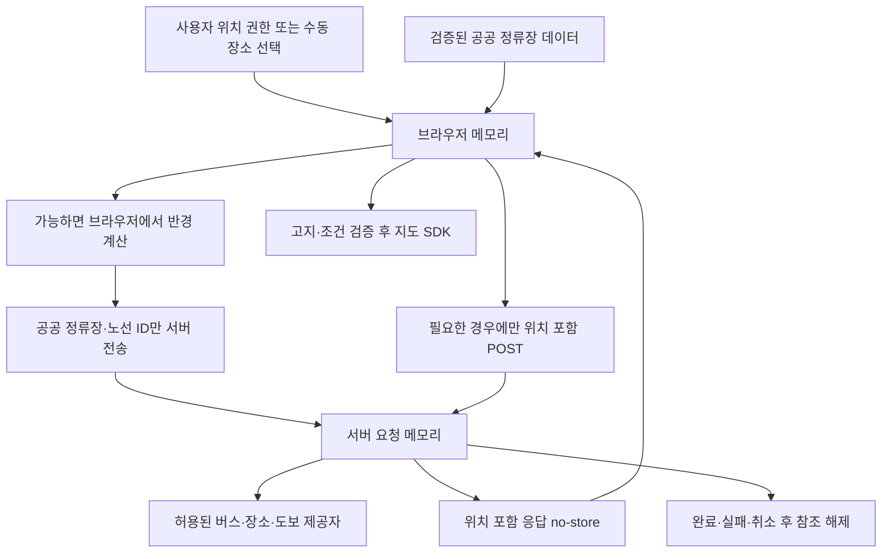

# TASK-001 — 개인정보·0원 비용·실호출 사전 설계

## 1. 기록과 결론

- 조사일: 2026-10-28 (Asia/Seoul), 조사 기준 시각 17:18 KST.
- 환경: 관리형 클라우드 `/workspace/jeju-smart-bus-codex-new`, `work`, 기준 커밋 `472f217bf306bfb4f320f7e6ddf15173e8870b4d`.
- 기준: 확정 PRD v1.0, AGENTS.md, IMPLEMENTATION_PLAN.md, tasks/TASK-001.md.
- 판정: **부분 — 사전 설계와 공개 공식 문서 조사 작성. 계정별 무료 자격·차단 설정·외부 위치 보관 조건은 보류.**
- 공개 웹 문서만 조회했다. 인증된 공급자 콘솔 조회·설정, 상품 신청, 키 발급, 지도 SDK 로드, 버스/장소/도보 API 실호출은 수행하지 않았다. 서비스 API 요청 수는 0건이다.
- 앱 코드·의존성·배포·저장소 연결은 생성하지 않았다. 기존 저장소와 기존 Vercel 프로젝트는 변경하지 않았다.
- 이 문서는 구현·운영 허가가 아니다. TASK-002에서도 아래 선행 조건을 만족한 호출만 허용한다. 모든 MVP FR/AC는 미구현/미검증을 유지한다.

## 2. 확정 정책과 제안의 구분

사용자 확정 정책: 월 외부 과금 0원, 위치 영구 저장 금지, 500m/동의 후 해당 위치만 1km, 최대 환승 2회, 시간 추천 최대 3개·미확인 최대 5개 및 PRD 정렬, MVP 생성형 AI 제외. 이 문서로 변경하지 않는다.

AI 제안: 브라우저에서 공공 정류장과 사용자 위치 사이의 거리 계산, 서버는 비밀키가 필요한 요청의 최소 중계, 위치 포함 응답 무저장, 서버에 공개 정류장 ID만 전달 가능한 기능은 좌표 전송 생략. 프레임워크 후보는 React/TypeScript/Vite이나 확정·설치하지 않는다. 공개 정류장 데이터 배포·재사용 조건과 전체 데이터 취득 가능성이 검증되어야 브라우저 계산 구조를 채택할 수 있다.

미결정: 지도·장소·도보·호스팅 공급자, 서버 런타임, 공개 데이터 저장 방식, 갱신·신선도 기준, 시간 산식, 경로 ID, 환승 정의·순환/분기 처리. 직선거리로 실제 보행거리·시간을 대체하거나 임의 보행속도를 정하지 않는다.

## 3. 공식 출처와 확인 범위

모든 출처 확인일은 2026-10-28 KST이다. 공개 문서의 설명과 실제 계정 상태를 구분한다. 아래는 요약이며 약관 원문을 복제하지 않는다.

| ID | 공식 출처 | 확인 결과와 한계 |
|---|---|---|
| S01 | https://www.data.go.kr/data/15058442/openapi.do | 제주 버스정보시스템. 무료·이용허락범위 제한 없음 표시. 개발/운영 자동승인 표시. 트래픽은 기관 정책에 따라 상이. LINK/XML이며 버스위치·노선/정류소 ID·상하행 등 설명. 완전한 정차 순서·도착시각 API를 보장하지 않음 |
| S02 | https://www.data.go.kr/data/15074254/openapi.do | 제주 버스 노선 기본 정보. 무료·이용허락범위 제한 없음. 개발 자동/운영 심의승인. 트래픽 수치 미제시. 노선 기본 필드는 전체 정차 순서와 다름 |
| S03 | https://www.data.go.kr/catalog/15074255/openapi.json | 제주 정류소 기본 정보 공식 카탈로그: 명칭·주소·방향·경위도 설명, 이용허락범위 제한 없음. 상세 페이지는 도구 접근 실패. 카탈로그 수정일 2021-02-05로 최신 계약·스키마·요금·쿼터 재확인 필요 |
| S04 | https://www.ncloud.com/charge/price/ko | 공개 요금 검색 결과에 Dynamic Map 월 6,000,000건 대표 계정 무료량과 0.1원/건 표시. 검색 색인 근거이므로 선택 상품의 현재 요금 원문·콘솔 대조 전 잠정 정보 |
| S05 | https://guide.ncloud-docs.com/docs/application-maps-app-vpc | Maps 대표 계정만 무료량 적용, 앱별 일/월 한도·한도 초과 사용 설정, Web 서비스 URL 등록. 계정 내 여러 앱 사용량의 합계와 실제 차단 설정은 미확인 |
| S06 | https://developers.kakao.com/docs/ko/getting-started/quota | 장소 키워드 검색 일 100,000건, Web 지도 일 300,000건, 도보 경로 일 1,000건. 전체 API 월간 3,000,000건도 문서에 명시되며 API별 차감·추가 쿼터 규칙을 함께 적용. 무료 자격은 S07 조건 필요 |
| S07 | https://developers.kakao.com/docs/ko/kakaomap/common | 개발자 계정의 첫 활성화 앱만 무료. 이후 앱/초과 이용은 비즈월렛·유료 API 설정 필요. 무료 소진 시 429. Web SDK는 JavaScript 키와 도메인 등록, REST 키와 구분 |
| S08 | https://developers.kakao.com/terms/ko/site-policies | 보안·개인정보 의무 확인. 이 운영정책만으로 API 좌표의 제공자 보관기간·재이용·응답 재배포 허용을 확정할 수 없음 |
| S09 | https://developers.kakao.com/terms/ko/site-terms | 서비스 약관 접근 확인. 선택 API의 저장/캐시/제3자 지도 조합 조건과 위치 처리에 관한 적용 조항 확정은 추가 검토 필요 |
| S10 | https://tmapapi.tmapmobility.com/terms.html | 무료 제공 표에 경로안내 일 1,000건, POI 일 20,000건. 무료체험 초과 사용은 별도 유료 가입 안내. 응답 데이터 저장 후 24시간 이상 사용 불가, 동일 서비스에 다수 프로젝트 사용 제한. 지속 무료 자격과 실제 차단 동작은 미확인 |
| S11 | https://vercel.com/docs/plans/hobby | Hobby는 개인·비상업 용도, 무료 한도 초과 시 기능 제한 및 대기 가능. 이번 서비스의 적합성·계정 한도 공유·로그 정책 미확인 |
| S12 | https://vercel.com/docs/plans | Hobby 포함량 초과 시 일시 중단, Pro의 종량 과금과 구분. 어떤 계정·플랜도 선택/연결하지 않음 |

검색 과정의 Ncloud 상품 요약 URL은 직접 열기 404였다. 그 결과를 운영 요금 확정 증거로 쓰지 않는다. 공공데이터 페이지의 메타데이터 '실시간' 표시도 개별 응답 신선도 증거가 아니다. 기존 PoC 성공·계정·키·무료 자격을 승계하지 않는다.

## 4. 공급자별 비용·인증·이용 조건 판정

| 대상 | 무료량/초과 과금 및 차단 | 인증/재사용·개인정보 | 판정·후속 |
|---|---|---|---|
| 제주 BIS / 공공데이터 | S01/S02는 무료, 수치 쿼터 미확인. 초과 오류·차단 방식 미확인 | 정확한 제공 호스트·인증 방식은 LINK 원본 명세 확인 필요. 해당 목록은 이용허락 제한 없음이나 실제 엔드포인트·첨부 명세와 대응 검증 필요. 사용자 위치 전송 없이 공공 ID 조회 우선 | 부분. 무료 문구만으로 실호출 허용하지 않음. 실제 서비스 신청/인증·잔여량·제공 URL 확정 필요 |
| NAVER Maps | S04 잠정 수치. S05에 일/월 한도 및 초과 사용 설정. 대표 계정 여부·다른 앱의 합산 사용량 미확인 | Client ID/Secret 구분, 브라우저용 식별자 공개 구조 검토 필요. 지도 SDK/타일 요청에서 IP·화면 범위·좌표 관련 정보가 제공자에 전달될 수 있음. 공급자 보관·재이용 조건 미확인 | 보류. 기존 앱 설정 변경 없이 이 프로젝트에 안전한 무료 예산을 확보할 수 있어야 후보 유지 |
| Kakao 지도·장소·도보 | S06/S07 무료 자격 조건. 유료 적용 단가는 지도 0.1원, 장소 검색 2원, 도보 10원/건으로 문서 표시. 유료 미설정·무료 자격·남은 일/월 예산 확인 필요 | REST 비밀키는 서버만, Web SDK 공개 키는 사용자 확인 후. 장소 결과와 다른 공급자 지도 결합·출처 표시·저장 조건 및 좌표 보관/재이용 미확인 | 보류. 지도·장소·도보를 같은 공급자로 구성하는 방안은 조사 우선 후보이며 선택 아님 |
| TMAP 보행자 | S10 수치는 무료체험 표이며 영구 무료 보장 아님. 유료 미가입 상태에서 차단되는지 계정·계약 근거 필요 | 서버 전용 인증 후보. 24시간 제한은 사용자 위치 24시간 저장 허가가 아님. 위치 보관·다른 지도 표시/재배포 조건 미확인 | 대안 후보 보류. 무료체험만으로 운영 채택 금지 |
| Vercel Hobby | 개인·비상업 무료 플랜의 제한 정책은 확인. 실제 계정 적합성 및 다른 프로젝트와 한도 공유 영향 미확인 | 요청 처리지역·플랫폼 로그·보관/삭제·캐시 검토 필요. 새 프로젝트만 추후 별도 지시로 생성 가능 | 호스팅 미선택. 기존 프로젝트·환경변수·도메인·배포 유지 |

호출 차단 설계 제안: 제공자 측 유료 미활성화/하드 한도를 1차 경계로 사용하고, 서버의 동시성 안전 예산과 기능별 중단을 2차 경계로 둔다. 전역 예산 저장소는 비용·저장 방식 검토 후 결정하며 위치를 저장하지 않는다. 인스턴스 메모리 카운터·알림·자동중단 모의 테스트만으로 0원을 보장하지 않는다. 무료 한도에 근접하는 고의 실험은 하지 않는다. 일/월 집계 시간대와 SDK 자동 요청·재시도·동시 요청까지 계산해야 한다.

## 5. 위치 데이터 흐름 설계 제안

위치 권한 허용이 외부 제공자 처리 조건 확인을 대신하지 않는다. GPS뿐 아니라 수동 선택 출발지·목적지·검색어·경로도 위치 관련 정보로 취급한다. 지도는 마커만이 아니라 중심/타일 범위로도 위치를 드러낼 수 있다. 서버 프록시를 사용해도 제공자 로그를 통제했다고 주장할 수 없다.

| 구간 | 전송·사용 최소화 | 저장/삭제 설계와 검증 |
|---|---|---|
| 브라우저 수집 | 사용자가 요청한 일회 위치 확보 우선. 연속 추적 불필요 | React 등 프레임워크와 무관하게 메모리만. localStorage/sessionStorage/IndexedDB/쿠키/히스토리에 좌표·검색 기록 저장 금지. 위치 변경·초기화·페이지 종료 시 참조 제거. 메모리 물리 소거를 보장한다고 표현하지 않음 |
| 브라우저→서버 | 고정 경로의 HTTPS POST 본문. URL·쿼리·해시·Referer에 좌표/장소명 금지. 정류장 조회에는 공공 ID만 | 본문·헤더·전체 URL 덤프 금지. Referrer-Policy: no-referrer 후보. 요청/응답 녹화·분석 SDK·세션 리플레이 미도입 |
| 서버 처리 | 스키마·길이·좌표 범위 검사, 필요한 필드만 제공자에 전달 | DB·파일·큐·분산 추적 baggage·전역 상태에 위치 금지. 완료/취소/실패 시 참조 해제. 프로세스 재사용·크래시 로그·APM까지 점검 |
| 서버→제공자 | 가능하면 ID만, 장소 검색은 위치 편향 없이 키워드만 우선. 도보는 필요한 끝점만 | GET만 지원하면 제공자 URL에 좌표/키가 포함될 수 있음을 PRIV-002/004에 기록. 클라이언트에 원문 URL·오류 반환 금지. HTTPS 미지원 시 민감정보 전송 보류 |
| 지도 SDK | 사용자에게 제공자·전송 범위 고지 후 필요한 시점에 로드하는 설계 | SDK 네트워크 목적지·텔레메트리·제공자 보관/재이용 조건 검증 전 활성화 금지 |
| 로그·오류 | 내부 요청 ID, 공급자 별칭, 결과 코드, 소요시간, 호출 개수만 허용 목록 후보 | 좌표·검색어·키·원문 본문·공급자 인증 URL·응답 전체 금지. IP/UA는 호스팅 기본 로그 정책 확인 후 최소화. 개발자 콘솔·프록시·CDN·오류 수집도 포함 |
| 응답·캐시 | 위치/선택 장소/경로가 포함되면 Cache-Control: no-store | CDN·서버·서비스워커·브라우저 공유 저장 우회 확인. ETag/304·리다이렉트·오류에도 정책 확인. Vary만으로 보호 완료 처리하지 않음 |
| 공공 데이터 캐시 | 사용자 요청과 분리된 정류장·노선 데이터만 후보 | 라이선스·공급자별 제한 확인 전 비활성. 저장 위치·TTL·갱신·폐기·오래됨 기준은 TASK-002 실측 후 결정. 사용자 중심 반경 결과/개인 경로는 공유 캐시 금지 |

필요 고지 초안 항목: 기능별 사용 목적, GPS/선택 위치/검색어 등 전송 항목, 수신 제공자, 보관·재이용과 삭제 조건, 동의 거부 시 수동 입력·목록 등 가능한 대안. 구체 문구와 필요한 동의 절차는 공급자 조건 확인 후 작성한다. 영구 저장이 없다는 이유만으로 외부 제공 고지를 생략하지 않는다.

## 6. 인증정보 설정 경로 제안

현재 관리 환경의 준비 상태 조회에는 설정된 secret/runtime variable이 없고, 저장소에도 env 예시·런타임 설정이 없다. 임의로 키 발급·로그인·상품 신청을 하지 않았다.

- 사용자가 서비스 선택 후 환경의 비밀정보 설정 UI에 서버 전용 키를 등록한다. 채팅·문서·명령행 인자에 실제 값을 전달하지 않는다.
- 후보 변수명은 `JEJU_BUS_API_KEY`, `KAKAO_REST_API_KEY`, `TMAP_API_KEY`, `NAVER_MAP_CLIENT_SECRET`이며 아직 생성·채택하지 않는다. 불필요한 공급자 키는 등록하지 않는다.
- `JEJU_BUS_API_KEY` 필요 여부도 실제 인증 명세 확인 후 결정한다. 키가 없다는 이유로 추측한 인증 URL을 시도하지 않는다.
- 서버 비밀키에는 `VITE_` 접두사를 사용하지 않는다. 추후 env 예시는 빈 자리표시자만, 실제 로컬 비밀 파일은 추적 제외 여부부터 검증한다.
- 지도 Client ID/JavaScript 키는 공개용 식별자인지 문서로 구분하고 도메인 제한·무료량 소모 위험·PRD 정합성을 설명한 뒤 사용자 확인을 받는다. 비밀키의 브라우저 노출을 정당화하는 예외로 쓰지 않는다.
- 기존 앱의 키·유료 설정·무료 자격·Vercel 환경변수는 복사하거나 변경하지 않는다. 무료량 확보를 위해 다중 앱·계정을 통한 한도 우회를 하지 않는다.

## 7. TASK-002 최소 실호출 계획 — 아직 실행 금지

### 시작 조건

1. 선택 API의 정확한 공식 명세 URL·엔드포인트·HTTPS·인증 방식·이용/재사용 조건을 확정한다. LINK 카탈로그를 실제 API로 오인하지 않는다.
2. 계정의 무료 자격, 일/월 잔여량, 과금 비활성화 또는 제공자 하드 차단, 집계 범위·시간대를 확인한다. 기존 프로젝트의 예산·설정을 변경할 필요가 있으면 그 후보는 보류한다.
3. 공공 장소 표본만 사용하고 사용자의 실제 위치·이동 경로는 수집하지 않는다. 제공자 보관·고지·로그/캐시 검증이 부족한 연동은 공공 좌표 표본이라도 AGENTS의 조건에 따라 보류한다.
4. 필요한 secret과 해당 호스트에 대한 관리 환경 네트워크 허용을 확보한다. 현재 제한 정책에는 버스·지도 API 호스트가 없어, 실제 대상 확정 후 지원되는 환경 설정 절차로 허용이 필요하다. 프록시 우회 금지.
5. 호출 전 요청별 예산 장부를 작성한다. 아래 수치는 **AI가 제안하는 1회 검증 세션의 최대 요청 수**이며 운영 쿼터·자동 실행 승인이 아니다. 조건 불충족 시 실제 허용량은 0이다.

| 요청 목적 | 최대 요청 | 표본·확인 항목 |
|---|---:|---|
| 정류장 목록/상세 | 2 | 공식 표본에서 실제 반환된 ID·명칭·위경도·좌표계. 다음 요청 ID를 임의 생성하지 않음 |
| 노선 기본 | 1 | 반환 노선 ID·번호·시종점·갱신 정보 |
| 노선별 정차 순서/방향 | 2 | 공식 문서로 확인한 기능만. 순환·분기 또는 반대 방향 표본은 예산 내 확보 가능한 경우에만 |
| 정류장별 경유노선 | 1 | 정류장/노선 ID와 경유 관계 대조 |
| 도착정보 | 2 | 서로 다른 관측 2회 이내, 산출시각·대기시간 단위·빈 응답·정류장 ID. 폴링 없음 |
| 시간표/운행정보 | 1 | 공식 원천이 있을 때만. 운행일·시간대·최신성·이용 조건 |
| 장소 검색 | 2 | 공공 시설명만, GPS 좌표·개인 주소 없음. 반환 ID·좌표·결과 상태 |
| 도보 경로 | 2 | 검증된 공공 지점 사이 2구간 이내, 실제 거리·시간 단위·산정시각 |
| 합계 | **13** | 리다이렉트·페이지 추가·재요청·오류 응답 모두 예산에 포함. 공급자 대안들을 각각 13회씩 실행하지 않음 |

지도 SDK 로드·화면 확대/이동은 숨은 다중 요청 수를 확정하지 못하므로 이 13회 계획에서 제외하고 허용량 0으로 둔다. 별도 계측 계획과 공급자 측 무료 한도 차단 확인 후에만 검토한다. 기능 미제공으로 남은 예산을 다른 API에 자동 전용하지 않는다. 최소 호출 표본으로 전 지역·모든 환승 유형을 검증했다고 주장하지 않는다.

### 중단 조건과 증거

- 인증/권한 오류, 429·쿼터 오류, 과금 가능성, 무료 자격 불명, 타임아웃·5xx·비정상 형식, HTTPS 실패, 예상 밖 리다이렉트, 위치/키 로그 발견 시 해당 공급자 호출을 즉시 중단한다. 자동 재시도·대체 공급자 자동 호출 금지.
- 필드 누락·ID/좌표계·방향 불일치는 해당 게이트를 보류하고 반복 호출로 추측하지 않는다. 정상 빈 응답은 '없음' 표본으로 기록하며 채우기 위해 반복 호출하지 않는다.
- 실제 한도를 소진하거나 유료 호출을 발생시키는 테스트는 하지 않는다. 차단 반응은 안전한 모의 주입, 공급자 설정·계약 증거, 실제 청구 확인을 각각 구분한다.
- 기록: 시각/환경, 출처 URL·확인일, 요청 목적/개수, 응답 허용 필드·단위·산출시각, 비식별 공공 표본, 판정, 영향 FR/AC, 다음 작업. 키·인증 URL·원문 요청 로그·사용자 좌표는 기록하지 않는다.
- 도보/대기/버스/환승 산식은 각 구간 시간의 의미와 출처 확인 후 제안한다. 도착예정시각만으로 구간 주행시간이나 전체 시간표를 대체하지 않는다.

## 8. 게이트 및 기능 착수 판정

| ID | 현재 판정 | 남은 증거·영향 |
|---|---|---|
| PRIV-001 | 부분 | 영구 저장 없는 흐름 설계. 구현·런타임·크래시 경로 미검증 → 실제 위치 기능 보류 |
| PRIV-002 | 부분 | URL/로그 최소화 설계. 호스팅·제공자·SDK·프록시 로그 미검증 → 관련 전송 보류 |
| PRIV-003 | 부분 | 위치 no-store·공유 캐시 금지 설계. 실제 헤더·CDN·브라우저 동작 미검증 → 관련 기능 보류 |
| PRIV-004 | 보류 | 제공자별 좌표 수신·보관·재이용·필요 고지와 데이터 조합 조건 미확정 → 외부 위치 연동 보류 |
| GATE-01~03 | 미검증 | 실응답 ID·좌표·정차순서·방향·정합성 없음 → 정류장/경로 구현 착수 불가 |
| GATE-04~05 | 미검증 | 도착·시간표·각 시간 원천/산식 없음 → 시간 추천·대체 추정 완료 불가 |
| GATE-06 | 부분 | 공개 비용 정책 일부 확인. 계정 인증·자격·잔여량·하드 차단·청구 미확인 → 실호출/운영 보류 |

허용: 독립 문서 조사, 공급자별 미결정 정리, 호출 계획 보완. 보류: 조건 미충족 API 실호출, 위치 기능·외부 연동, 앱 코드·설치·배포. 이 판정은 FR 구현 완료나 출시 승인을 뜻하지 않는다.

관련 FR/AC: 직접 추적은 PRIV-001~004, GATE-06, U-001/U-009, NFR-001~003/006. 영향은 FR/AC-001~018 및 020이며 특히 위치·지도·장소·도보·장애/비용 기능이다. FR-019/AC-019는 후속 제외 유지.

## 9. 미결정과 권고 순서

1. **무료 자격과 기존 서비스 격리:** NAVER 대표 계정 잔여 무료량 또는 Kakao 첫 활성화 앱 자격을 확인해야 한다. 새 앱이 유료가 된다면 선택하지 않는다. 기존 앱 설정 변경·키 공유를 전제로 하지 않는다.
2. **공급자 후보:** Kakao 지도/장소/도보의 동일 공급자 조합을 먼저 추가 검토하고 NAVER 지도 조합·TMAP 도보를 대안으로 유지한다. 지도 간 데이터 혼합·캐시·표시 조건을 확인하기 전 선택하지 않는다.
3. **외부 개인정보:** 각 API에 적용되는 위치 수신·보관/재이용 조건과 호스팅 로그를 확인한다. 조건 불명은 제공자 측 무저장의 증거가 아니다.
4. **버스 원천:** S01~03의 LINK 원본 명세·실제 기능·인증·무료 쿼터를 확보한다. 정류장 데이터와 노선 기본 목록만으로 경로 엔진 가능성을 확정하지 않는다.
5. **스택·호스팅:** React/TypeScript/Vite와 최소 서버 중계를 제안하되 TASK-002 결과 후 TASK-003에서 결정한다. Vercel Hobby는 비상업 용도 적합성·기존 계정 한도 영향 확인 전 미선택이다.
6. **후속 결정:** U-002 시간 원천/산식, U-003 고정 ID, U-006 실 API, U-007 KPI는 유지한다. U-004/008/010은 재개방하지 않는다.

TASK-002는 조건이 충족된 공급자부터 수행할 수 있지만 현재 모든 서비스의 실호출 허용량은 0이다. 앱 개발은 TASK-003의 별도 개발 지시와 기능별 게이트 통과 이후다.

## 10. 수행 검증과 한계

- 수행: 저장소·브랜치·기준 상태 확인, 공식 웹 문서 조회, 데이터 흐름/비용/호출 예산/미결정의 PRD 대조, 문서 링크·변경 범위·공백 검사.
- 미실행: 서비스 API 실호출, 공급자 콘솔/실제 청구·차단 설정 확인, 앱 테스트·빌드, 모바일·SDK·헤더·로그·캐시 실측. 문서 검사로 이 항목들을 통과 처리하지 않는다.
- PRD 원문·기존 저장소·Vercel은 변경하지 않는다. TASK-001은 부분 완료이며 남은 공식 계약/계정 검증을 닫기 전 완전 완료로 표기하지 않는다.
